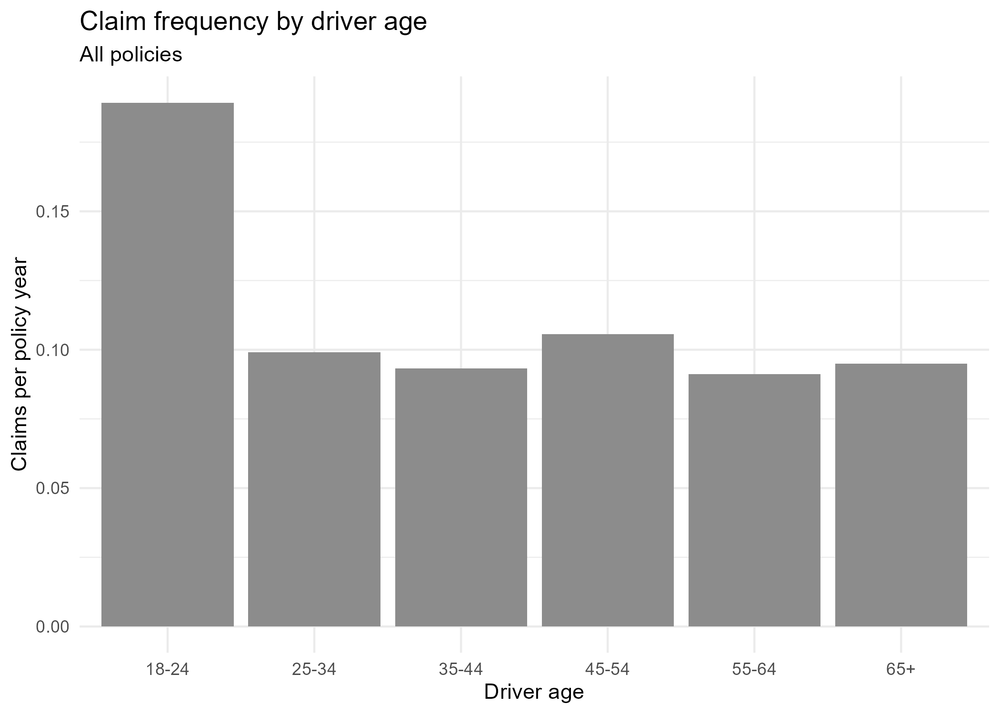
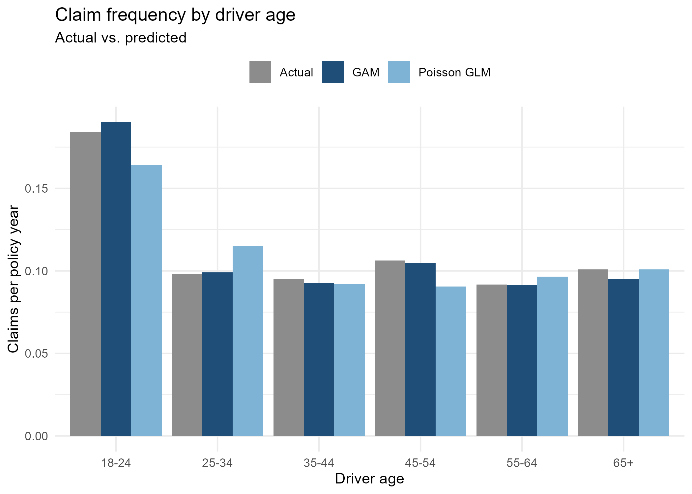
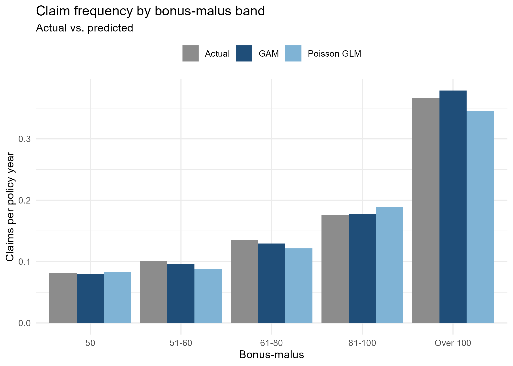
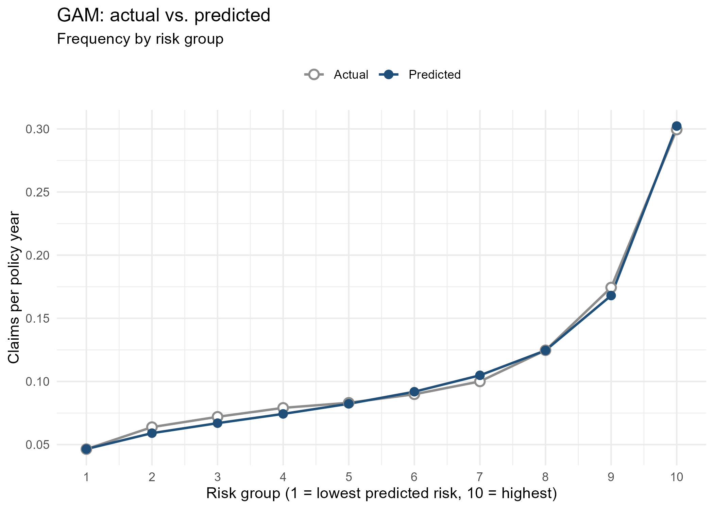
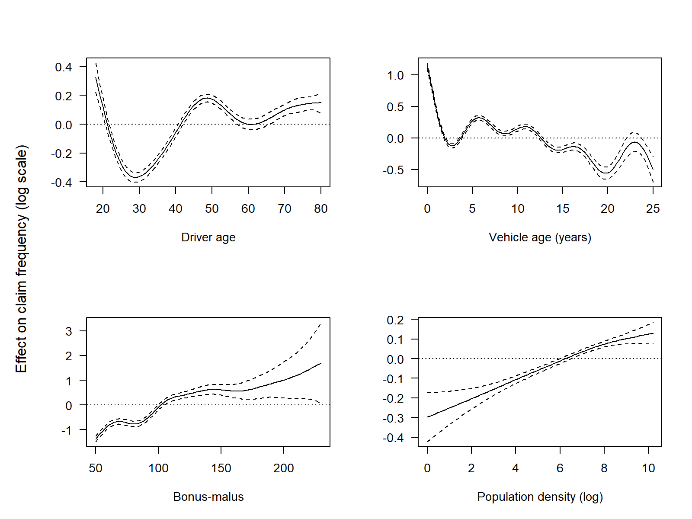
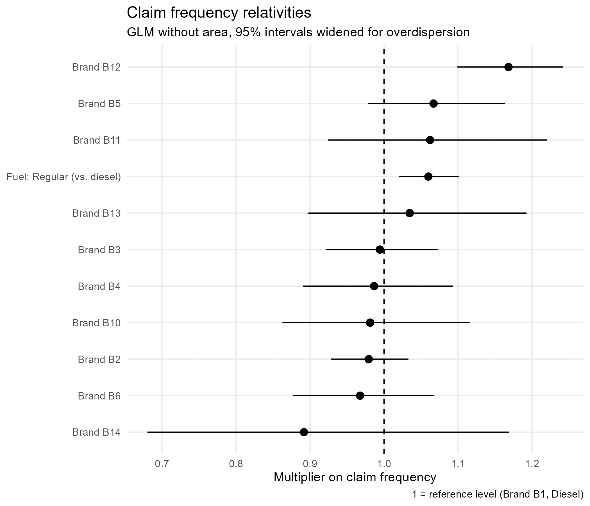

**Questions**

- How often are auto insurance claims filed based on policyholder and vehicle characteristics
- How well can those characteristics predict claim frequency for pricing?

**Data**

I used the French Motor Third-Party Liability data set (freMTPL2freq) from Kaggle, which contains 678,013 policies. It shows the number of claims, the exposure (the fraction of a year the policy was active), and rating variables for each policy: driver age, vehicle age, vehicle power, vehicle brand, fuel type, bonus-malus, population density, and region. Claim frequency is defined as claims divided by exposure, or claims per policy year.

While cleaning the data, I capped some extreme values: claim counts were capped at 5, exposure at 1 (since exposure above 1 year is an error), vehicle age at 25, and driver age at 80. These caps affected 7, 1,224, 2,619, and 6,180 policies, each under just 1% of the given data.

**Method**

The policies were split at random into a training set (80%) and a test set (20%). The models were first built on the training set, and all of the results below use the test set, which the models had never seen.

The three approaches were then compared:

[Baseline]{.underline}: one claim rate for every policy with no rating variables.

[Poisson GLM (generalized linear model)]{.underline}: the standard approach for claim counts; each rating variable has a straight-line effect, and effects multiply together.

[GAM (generalized additive model)]{.underline}: the same approach as the GLM except numeric variables (driver age, vehicle age, bonus-malus, and density) can follow a curve instead of a straight line.

Since exposure is built into both models, I expected a policy covered for three months to have a quarter of the claims of a policy covered for a full year.

Models were then compared using Poisson deviance, which measures how far predicted claim counts are from actual claim counts; lower is better since it is a measure of error.

Area is a grouped version of population density, so I tested whether it adds anything beyond density. Since dropping it made almost no difference, the final models leave it out.

**Results**

Across all of the policies, drivers aged 18 to 24 have the highest claim frequency by a wide margin, at about 0.19 claims per policy year. That is almost double the roughly 0.10 seen in every other age group. Then from age 25 onward, frequency remains fairly flat, with a small increase from ages 45 to 54.

[Comparison of Models]{.underline}

| Model                 | Train deviance | Test deviance | Improvement vs. baseline |
|------------------|------------------|------------------|-------------------|
| Baseline              | 0.330          | 0.333         | n/a                      |
| Poisson GLM           | 0.319          | 0.324         | 2.89%                    |
| Poisson GLM (no area) | 0.319          | 0.324         | 2.88%                    |
| GAM                   | 0.313          | 0.318         | 4.57%                    |
| GAM (no area)         | 0.313          | 0.318         | 4.57%                    |

Both the GLM and the GAM beat the baseline model; the GAM did better than the GLM by around 1.7 percentage points. Results on the training data and the test data were close, so the models are not just memorizing the data they were built on (overfitted).

Dropping the area lowered the GLM's improvement by 0.01 of a percentage point (2.89% to 2.88%) and did not change the GAM, so the final models leave it out as the difference is negligible.

[Check on longer policies]{.underline}

| Model (no area) | Test deviance | Improvement vs. baseline |
|-----------------|---------------|--------------------------|
| Baseline        | 0.366         | N/A                      |
| Poisson GLM     | 0.357         | 2.64%                    |
| GAM             | 0.354         | 3.41%                    |

Claim counts are the most unpredictable for policies covered for less than three months. To check that the results didn't depend on those, I repeated the comparison using only policies with more than three months of coverage. The improvements are smaller (2.64% and 3.41%, respectively), but the order is the same: the GAM beats the GLM which beats the baseline. Each improvement is measured against that group's own baseline, so the deviance values can't be compared with the table above.

On the test set, the GAM matches the actual claim frequency closely within every age group, while the GLM misses them in a few places. It expects about 0.16 for drivers 18 to 24 when the actual is about 0.19, and it also expects too little for ages 45 to 54, while it expects too much for ages 25 to 34. This is due to the GLM treating the effect of age as a straight line, while the real pattern is not.

Bonus-malus is the system that adjusts a driver's premium based on claims history (good driving history vs. bad driving history). 100 is neutral, below 100 is a no-claims discount, and above 100 is a surcharge. Claim frequency rises from about 0.08 in the lowest band to about 0.37 in the highest, which is more than four times as high; of the variables looked at by the band, this shows the largest spread. The GAM is close to the actual in every band, while the GLM falls short in the highest band (about 0.35 vs. 0.37 actual) and in the middle bands.

The test policies are ranked by the GAM's expected claim frequency and split into 10 equal groups, and expected and actual claims are close in every group. The lowest-risk group has about 0.05 claims per policy year, and the highest-risk group has about 0.30, about six times as many. This shows the model separates lower-risk policies from higher-risk ones, which is exactly what a pricing model needs to do.

Each panel shows how one variable changes expected claim frequency while holding the others fixed. A value of 0 is average, above 0 is higher than average, and below 0 is lower, while the dashed lines show the uncertainty.

- Driver age: as expected, frequency is highest for the youngest drivers, while the lowest is around age 30, rising to a second peak near age 50, and then leveling off.

- Vehicle age: frequency is much higher for vehicles under around two years old, then falls. The small bumps after that are potentially some random noise and should not be read as real effects.

- Bonus-malus: frequency rises as bonus-malus rises. The range of uncertainty becomes wide above about 180 as there are fewer policies there.

- Population density: frequency rises steadily with density. The densest areas are around 1.5 times as high as the least dense.

Relativity is a multiplier on claim frequency compared with a base level, while holding the other variables fixed; here, a value of 1 means no difference. The base brand is B1 and the base fuel type is diesel. The lines show a 95% range, widened since claim counts varied more than the model expects.

Brand B12 is around 17% higher than B1, with its range above 1. Regular fuel is around 6% higher than diesel, with its range above 1. The other brands are close to 1, and their ranges include 1, so the data does not show a clear difference from the base B1 brand. Brand B14 has the widest range because it has the least data.

**Conclusions**

Young drivers, from 18 to 24, have around twice the claim frequency compared to any other age group; they file almost twice as many claims per year of coverage. Bonus-malus shows the largest spread of the variables when looked at by band, with the highest band claiming more than four times as often as the lowest. Both models end up beating the given flat-rate baseline; the GAM beats the GLM (4.57% vs. 2.88%) because it captures other effects, not just straight lines, especially for driver age, vehicle age, and bonus-malus. Finally, the riskiest 10% of policies have about six times the claim frequency as the least risky 10%.

**Limitations**

This models claim frequency only. It doesn't cover the full price, which also needs the average cost per claim, so these results are only one half of a premium. Claim counts varied more than the model assumes (dispersion was at around 2.5). This was mainly for policies with under three months of exposure, where it was about 5.6 compared with about 1 or less for longer policies; that affects how certain the relativities are, not the predictions. While the model describes patterns in the data, it doesn't show that any variable causes more claims.

**What's next**

We could fit a Gamma GLM on the companion claim amounts file (freMTPL2sev) and combine it with this frequency model to get a pure premium (the full cost side of a price). A negative binomial model would also handle the extra variation in claim counts more fully than widening the intervals. We could also build a rating table showing how the premium changes for a few example drivers.
